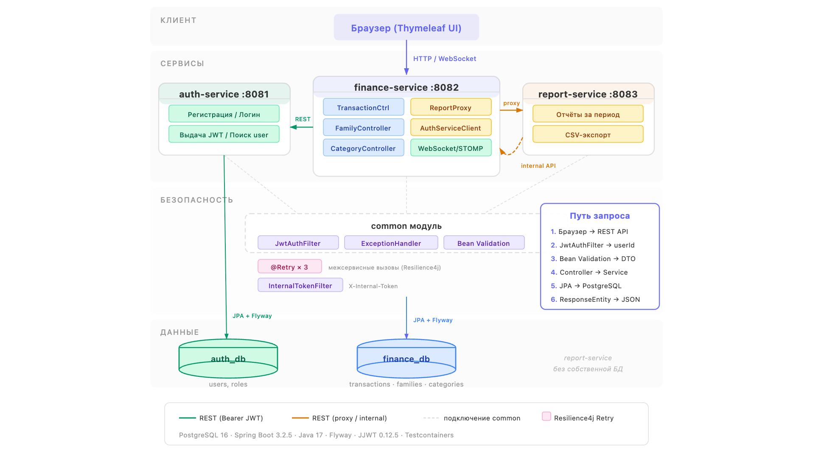

# Система учёта семейных финансов

Веб-приложение, которое я разработала для учёта личных и семейных финансов. Можно зарегистрироваться, создавать семьи/группы, добавлять доходы и расходы, строить отчёты за любой период с разбивкой по категориям и участникам, а также выгружать их в CSV.

## Архитектура

Микросервисная система из трёх сервисов и одного общего модуля:



| Сервис | Порт | Что делает |
|--------|------|------------|
| **auth-service** | 8081 | Регистрация, авторизация, выдача JWT-токенов, поиск пользователей |
| **finance-service** | 8082 | Операции (доходы/расходы), категории, семьи/группы, Thymeleaf UI, WebSocket-уведомления |
| **report-service** | 8083 | Построение отчётов за период, агрегация по категориям и участникам, экспорт в CSV |
| **common** | — | Общий модуль: JWT-фильтр, обработка ошибок, DTO, Security-конфигурация |

### Как сервисы общаются между собой

Вся коммуникация синхронная, через REST:

- **finance-service → auth-service** — когда пользователь добавляет участника в семью, finance-service ищет его по email в auth-service
- **finance-service → report-service** — UI проксирует запросы на построение отчётов
- **report-service → finance-service** — report-service запрашивает транзакции по внутреннему API, защищённому токеном `X-Internal-Token`

Для надёжности на все межсервисные вызовы я настроила Retry через Resilience4j — если сервис кратковременно недоступен, запрос повторится до трёх раз.

## Запуск

### Docker Compose (рекомендуется)

```bash
docker-compose up --build
```

Поднимутся 5 контейнеров: 2 PostgreSQL + 3 сервиса. После запуска UI доступен на http://localhost:8082.

### Локально

1. Поднять PostgreSQL с двумя базами:
   - `auth_db` на порту 5432
   - `finance_db` на порту 5433
2. Запустить каждый сервис:
   ```bash
   ./gradlew :auth-service:bootRun
   ./gradlew :finance-service:bootRun
   ./gradlew :report-service:bootRun
   ```

## Swagger UI

- auth-service: http://localhost:8081/swagger-ui.html
- finance-service: http://localhost:8082/swagger-ui.html
- report-service: http://localhost:8083/swagger-ui.html

## Переменные окружения

| Переменная | Описание | По умолчанию |
|------------|----------|--------------|
| `INTERNAL_TOKEN` | Токен для внутренней коммуникации между сервисами | `REDACTED_INTERNAL_TOKEN` |
| `SPRING_PROFILES_ACTIVE` | Активный профиль (`docker` для контейнеров) | не задан |

## Структура проекта

```
family-finance/
├── common/                # Общие классы: JWT, Security, обработка ошибок
├── auth-service/          # Сервис авторизации
├── finance-service/       # Основной сервис: операции, семьи, UI
├── report-service/        # Сервис отчётов и экспорта
├── docker-compose.yml     # Конфигурация запуска
├── docs/adr/              # Обоснования архитектурных решений, которые просили обосновать в README
└── build.gradle           # Корневая конфигурация Gradle
```

## Почему я выбрала именно эти технологии

Подробнее про каждое решение — в отдельных документах:

- [Spring MVC вместо WebFlux](docs/adr/001-spring-mvc.md)
- [Spring Data JPA](docs/adr/002-spring-data-jpa.md)
- [PostgreSQL](docs/adr/003-postgresql.md)
- [Синхронный REST между сервисами](docs/adr/004-sync-rest.md)
- [JWT для авторизации](docs/adr/005-jwt.md)
- [Retry (Resilience4j)](docs/adr/006-retry.md)
- [Flyway для миграций](docs/adr/007-flyway.md)
- [Отдельные БД для сервисов](docs/adr/008-database-per-service.md)

Если коротко:

Я выбрала **Spring MVC**, потому что проект работает с JPA (блокирующий I/O) и Thymeleaf - оба несовместимы с реактивным WebFlux. Для CRUD-приложения с синхронным взаимодействием MVC проще и надёжнее.

Для доступа к данным - **Spring Data JPA** — в доменной модели много связей (User → Family → FamilyMember → Transaction → Category), и JPA позволяет удобно описать их аннотациями, писать кастомные JPQL-запросы и управлять транзакциями через `@Transactional`.

**PostgreSQL** - потому что финансовые данные требуют ACID-гарантий, а реляционная модель хорошо ложится на домен. Для каждого сервиса я завела отдельную базу, чтобы обеспечить изоляцию данных.

Между сервисами выбрала **синхронный REST** - во всех сценариях пользователь ждёт ответ здесь и сейчас. Асинхронные очереди вроде Kafka или RabbitMQ добавили бы инфраструктурную сложность без реального выигрыша.

**JWT** даёт stateless-аутентификацию: сервисам не нужно каждый раз обращаться к auth-service для проверки токена - он валидируется локально через общий секрет из common-модуля.

**Retry** через Resilience4j я добавила, чтобы межсервисные вызовы не падали при кратковременных сбоях - повтор до 3 раз с паузой 500ms, и только для `ServiceUnavailableException`.

**Flyway** гарантирует воспроизводимость миграций БД в любом окружении - миграции лежат в коде и применяются автоматически при старте.

**Отдельные базы для сервисов** - auth-service не лезет в таблицы finance-service и наоборот. Это обеспечивает слабую связанность и в перспективе позволит разворачивать сервисы независимо.
