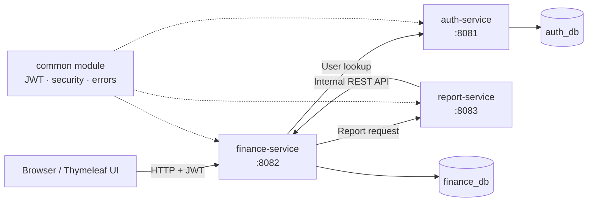

<h1 align="center">Family Finance</h1>

<p align="center">
  A web application for managing personal and shared finances
</p>

<p align="center">
  
  
  
  
</p>

<p align="center">
  <strong>English</strong> · <a href="README_RU.md">Русский</a>
</p>

## About the project

I built **Family Finance** to explore how a real backend system can manage personal and shared financial data. A user can record income and expenses, create a family group, invite other registered users, and see how money is distributed between categories and group members.

My main focus was the backend architecture. I divided the application into three Spring Boot services, added authentication and access rules, set up separate databases, and implemented communication between the services. I also created a simple web interface, so the main scenarios can be tested without an external client.

## What the application can do

- register users and authenticate them with JWT;
- store personal and family income and expenses;
- use built-in categories or create custom ones;
- create financial groups and manage their members by email;
- protect private data and allow only a group owner to manage members;
- filter operations by period, type, category, family, or member;
- show the current month's balance and recent operations on a dashboard;
- build personal, family, and combined reports for any date range;
- calculate income, expenses, balance, and totals by category or member;
- export reports as CSV files;
- publish WebSocket notifications when a new family operation is added;
- explore and test each service through Swagger UI.

## Architecture



| Module | Responsibility |
| --- | --- |
| `auth-service` | Registration, login, password hashing, JWT creation, and user lookup |
| `finance-service` | Transactions, categories, family groups, access control, web UI, and WebSocket events |
| `report-service` | Report calculation, aggregation by category and member, and CSV export |
| `common` | Shared JWT filter, security classes, error responses, and exceptions |

The services communicate through synchronous REST calls. Short temporary failures are handled with Resilience4j Retry. The internal endpoint used by the report service is protected with an `X-Internal-Token` header.

More details about the main technical decisions are available in [`docs/adr`](docs/adr).

## Technology stack

- Java 17 and Gradle
- Spring Boot, Spring MVC, Spring Security, and Spring Data JPA
- PostgreSQL and Flyway migrations
- JWT and BCrypt password hashing
- Thymeleaf, JavaScript, and WebSocket/STOMP
- Resilience4j Retry
- Docker and Docker Compose
- JUnit 5, MockMvc, H2, and Testcontainers
- OpenAPI / Swagger UI

## Quick start with Docker

### Requirements

- Git
- Docker with Docker Compose

### Run the application

```bash
git clone https://github.com/syldysh/Family-finance.git
cd Family-finance
cp .env.example .env
# Replace every placeholder in .env with your own local value.
docker compose up --build
```

Docker Compose starts three application services and two PostgreSQL containers. When all services are ready, open:

**http://localhost:8082/login**

Create an account, sign in, and add your first operation. To test family features, register a second account and add it to a group by email.

To stop the application:

```bash
docker compose down
```

Docker Compose reads the database credentials, JWT signing key, and internal service token from `.env`. This file is ignored by Git and must never be committed. You can generate random values for `JWT_SECRET` and `INTERNAL_TOKEN` with `openssl rand -base64 48`.

Database data is stored in Docker volumes and stays available after a normal restart. To remove the local data as well, use `docker compose down -v`.

## Local development

For a local run without Docker, install Java 17 and PostgreSQL. Create two databases on `localhost:5432`:

- `auth_db`
- `finance_db`

Copy `.env.example` to `.env`, replace all placeholders, and export the variables before starting the services:

```bash
cp .env.example .env
# Edit .env first.
set -a
source .env
set +a
```

Start each service in a separate terminal:

```bash
./gradlew :auth-service:bootRun
./gradlew :finance-service:bootRun
./gradlew :report-service:bootRun
```

The services use these ports:

| Service | Port |
| --- | ---: |
| Authentication API | `8081` |
| Main API and web interface | `8082` |
| Reporting API | `8083` |

## API documentation

After startup, Swagger UI is available for every service:

- Auth service: http://localhost:8081/swagger-ui.html
- Finance service: http://localhost:8082/swagger-ui.html
- Report service: http://localhost:8083/swagger-ui.html

Protected endpoints require a JWT from the login or registration response. For a direct API request, send it in the `Authorization: Bearer <token>` header.

## Tests

Run the complete test suite with:

```bash
./gradlew test
```

The project contains unit and integration tests for authentication, access control, family management, transactions, reports, CSV export, REST controllers, and database operations.

## Project structure

```text
Family-finance/
├── auth-service/       # Authentication and users
├── finance-service/    # Core domain, API, and web interface
├── report-service/     # Reports and CSV export
├── common/             # Shared security and error handling
├── docs/adr/           # Architecture decision records
├── docker-compose.yml  # Full local environment
├── build.gradle        # Shared Gradle configuration
└── settings.gradle     # Multi-module project settings
```

## What I practised

This project helped me practise domain modelling, service separation, secure REST APIs, database migrations, access control, inter-service communication, and automated testing. It also showed me where microservices add useful boundaries and where they create extra operational work.
