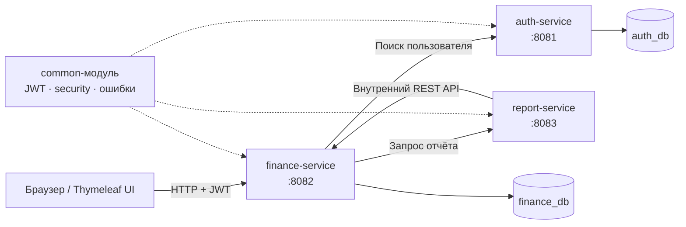

<h1 align="center">Family Finance</h1>

<p align="center">
  Веб-приложение для учёта личных и семейных финансов
</p>

<p align="center">
  
  
  
  
</p>

<p align="center">
  <a href="README.md">English</a> · <strong>Русский</strong>
</p>

## О проекте

Я создала **Family Finance**, чтобы разобраться, как полноценная backend-система может работать с личными и общими финансовыми данными. В приложении можно учитывать доходы и расходы, создавать семейные группы, добавлять других зарегистрированных пользователей и смотреть, как деньги распределяются между категориями и участниками.

Основное внимание я уделила backend-архитектуре. Я разделила приложение на три Spring Boot-сервиса, добавила аутентификацию и правила доступа, настроила отдельные базы данных и взаимодействие между сервисами. Также я сделала простой веб-интерфейс, чтобы основные сценарии можно было проверить без отдельного клиента.

## Возможности

- регистрация и вход с помощью JWT;
- учёт личных и семейных доходов и расходов;
- готовые категории и возможность создавать свои;
- создание финансовых групп и управление участниками по email;
- защита личных данных и управление участниками только владельцем группы;
- фильтрация операций по периоду, типу, категории, семье или участнику;
- баланс за текущий месяц и последние операции на главной странице;
- личные, семейные и общие отчёты за любой период;
- расчёт доходов, расходов, баланса и сумм по категориям и участникам;
- выгрузка отчётов в CSV;
- WebSocket-уведомления при добавлении новой семейной операции;
- документация и проверка API через Swagger UI.

## Архитектура



| Модуль | Ответственность |
| --- | --- |
| `auth-service` | Регистрация, вход, хеширование паролей, выдача JWT и поиск пользователей |
| `finance-service` | Операции, категории, семейные группы, проверка доступа, веб-интерфейс и WebSocket-события |
| `report-service` | Расчёт отчётов, группировка по категориям и участникам, экспорт в CSV |
| `common` | Общий JWT-фильтр, классы безопасности, ответы с ошибками и исключения |

Сервисы общаются друг с другом синхронно через REST. Кратковременные сбои обрабатываются с помощью Resilience4j Retry. Внутренний endpoint, который использует сервис отчётов, защищён заголовком `X-Internal-Token`.

Подробнее основные технические решения описаны в [`docs/adr`](docs/adr).

## Технологии

- Java 17 и Gradle
- Spring Boot, Spring MVC, Spring Security и Spring Data JPA
- PostgreSQL и миграции Flyway
- JWT и хеширование паролей с BCrypt
- Thymeleaf, JavaScript и WebSocket/STOMP
- Resilience4j Retry
- Docker и Docker Compose
- JUnit 5, MockMvc, H2 и Testcontainers
- OpenAPI / Swagger UI

## Быстрый запуск через Docker

### Что понадобится

- Git
- Docker с Docker Compose

### Запуск приложения

```bash
git clone https://github.com/syldysh/Family-finance.git
cd Family-finance
docker compose up --build
```

Docker Compose запустит три сервиса приложения и два контейнера PostgreSQL. Когда все сервисы будут готовы, откройте:

**http://localhost:8082/login**

Создайте аккаунт, войдите и добавьте первую операцию. Чтобы проверить семейные функции, зарегистрируйте второй аккаунт и добавьте его в группу по email.

Остановить приложение можно командой:

```bash
docker compose down
```

Данные сохраняются в Docker volumes и остаются после обычного перезапуска. Если нужно удалить и локальные данные, используйте `docker compose down -v`.

> Пароли и внутренний токен по умолчанию предназначены только для локальной разработки. Для другого окружения их необходимо заменить.

## Локальная разработка

Для запуска без Docker установите Java 17 и PostgreSQL. Создайте две базы на `localhost:5432`:

- `auth_db`
- `finance_db`

По умолчанию имя пользователя и пароль — `postgres`. Их можно изменить в конфигурационных файлах сервисов.

Запустите каждый сервис в отдельном терминале:

```bash
./gradlew :auth-service:bootRun
./gradlew :finance-service:bootRun
./gradlew :report-service:bootRun
```

Сервисы используют следующие порты:

| Сервис | Порт |
| --- | ---: |
| API аутентификации | `8081` |
| Основной API и веб-интерфейс | `8082` |
| API отчётов | `8083` |

## Документация API

После запуска Swagger UI доступен для каждого сервиса:

- Auth service: http://localhost:8081/swagger-ui.html
- Finance service: http://localhost:8082/swagger-ui.html
- Report service: http://localhost:8083/swagger-ui.html

Для защищённых endpoint нужен JWT из ответа на регистрацию или вход. При прямом запросе к API передайте его в заголовке `Authorization: Bearer <token>`.

## Тесты

Запустить все тесты можно командой:

```bash
./gradlew test
```

В проекте есть модульные и интеграционные тесты для аутентификации, проверки прав доступа, семейных групп, операций, отчётов, экспорта CSV, REST-контроллеров и работы с базой данных.

## Структура проекта

```text
Family-finance/
├── auth-service/       # Аутентификация и пользователи
├── finance-service/    # Основная логика, API и веб-интерфейс
├── report-service/     # Отчёты и экспорт CSV
├── common/             # Общая безопасность и обработка ошибок
├── docs/adr/           # Описания архитектурных решений
├── docker-compose.yml  # Полное локальное окружение
├── build.gradle        # Общая конфигурация Gradle
└── settings.gradle     # Настройки многомодульного проекта
```

## Что я изучила на практике

Этот проект помог мне лучше разобраться в моделировании предметной области, разделении сервисов, безопасности REST API, миграциях базы данных, проверке прав доступа, межсервисном взаимодействии и автоматическом тестировании. Я также увидела, где микросервисы дают полезное разделение ответственности, а где добавляют инфраструктурную сложность.
